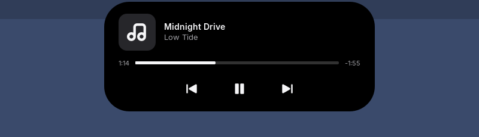
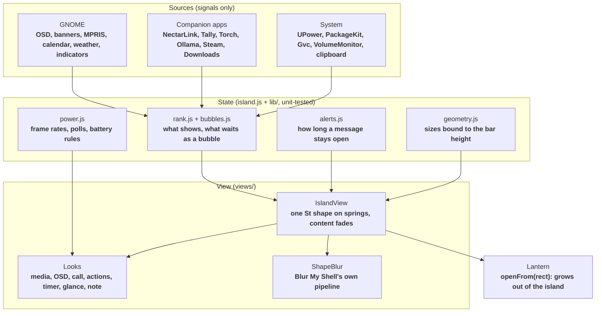
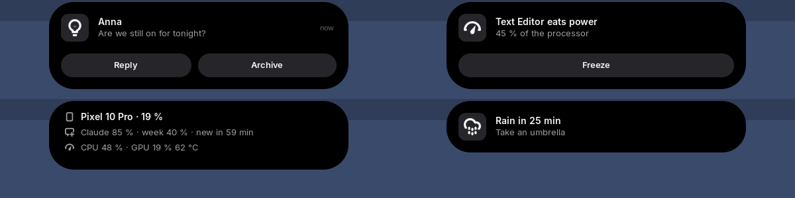

<div align="center">
  <h1>Islands</h1>
  <p><strong>A Dynamic Island for the GNOME top bar. Music, volume, notifications, calls, timers and a few companion apps grow out of a black pill in the middle of the bar and shrink back into it.</strong></p>

  <p>
    
    
    
    
    
  </p>
</div>

---



---

Every claim below says how it is known: *tested* (and how), *built* (it loads and runs in the headless shell, but the real thing was not there to try it with) or *planned*. All tests so far ran in **GNOME Shell 50.6** without a screen (`tools/headless`); Islands has **not yet run in a real login session**. Treat it as a preview.

---

## Architecture Overview

**Islands** is a **GNOME Shell 50** extension (`islands@thomashaiden`). The island is one **St** shape above the bar that springs between its sizes. What it shows is worked out from plain values in `extension/lib/` and drawn by **looks** in `extension/views/looks/`. Each **source** in `extension/sources/` listens to one signal (D-Bus, a GNOME object, a watched file) and calls `island.set()` or `island.remove()`. Nothing polls while nothing goes on.



---

## The Island

- **Lives in the Bar:** The pill is the bar's height minus 6 px (**26 px** at a 32 px bar), **124 px** wide at rest, centred. It opens below the bar only on a click, on hover, or for a short message that shrinks back by itself. *Tested* headless (`states`).
- **Bubbles:** Other running things sit right of the pill as 26 px **bubbles**, 0 to 10 of them (default 3). When more run, the last bubble counts the rest as **+N**. A click brings one forward, a right click sends the shown one aside. *Tested* (`bubbles`: 0, 1, 3 and 10 with 12 running).
- **Look:** Black, as on the Mac. With **Blur My Shell** enabled, the island borrows its blur pipeline and its window opacity over the dark bar colour. *Tested* (`states` with `ISLANDS_WITH=blur-my-shell@aunetx`).
- **Motion:** Springs for the shape (grow **0.58 / 340**, shrink **0.75 / 420**, hover **0.7 / 520**), whole pixels on every frame. Content only fades (out **90 ms**, in **170 ms** after 110 ms). A spring asked again for the target it is already heading to keeps its speed instead of starting over. *Tested* headless (`churn`). The feel on a real screen has not been checked.
- **Changes in Place:** A volume step, a growing download, a new battery percentage or a music player's position update the labels of the look that is already shown. They do not fade it out and in again. *Tested* (`churn`, see the power table).
- **Hover:** The empty island grows **3.5 %**, or opens a **glance** (next event, weather, phone, Claude's limits, CPU and GPU from **Torch**, Ollama) when there is something to show. The pointer holds an open message open; it never reopens one that has already shrunk. *Tested* (`events`, `stage2`, `stage3`).
- **Fullscreen:** Running things float 6 px below the edge, the empty island hides (setting). *Built*; with a fullscreen window only the frame count was tested (`perf`).
- **Clock:** Not part of the island. GNOME's clock sits in the same bar centre and peeks out at the ends of the empty pill, so the settings link to **Top Bar Organizer** to move it. *Tested* (`prefs`).




All screenshots come from the headless shell (`tools/headless`, a 1280 x 800 virtual monitor with a plain background and a see-through bar), not from a real desktop.

---

## What It Shows

| **Activity** | **Signal** | **Evidence** |
| :--- | :--- | :--- |
| **Volume, brightness, Caps Lock** | `OsdWindowManager._showOsdWindow`, shadowed; GNOME's own window stays hidden | *tested* (`sources`, `monitors`) |
| **Notifications** | `MessageTray._showNotification`, shadowed; 452 x 78 for 5 s, 132 high with buttons | *tested* with `notify-send` |
| **Calls** | notification category `call.*`; opens for 6 s, then rings on in the bar with answer and decline | *tested* with `notify-send` |
| **Alarms** | GNOME Clocks' notifications, with Stop and Snooze | *built* |
| **Music** | GNOME's MPRIS list (all players); a level at 20 fps in the cover's colour | *tested* with a stand-in player |
| **Timer, stopwatch, pomodoro** | **Ledge**'s shared `timers.json` (GNOME Clocks keeps its running timers private) | *tested* |
| **Events** | the date menu's calendar source; 10 min ahead and at the start | *tested* with a stand-in calendar |
| **Camera, microphone, screen sharing, recording** | GNOME's own indicators and the screenshot UI | sharing *tested*; the others *built* |
| **Lantern** | a click on the empty island or Lantern's shortcut: Lantern grows out of the island and back | *tested* (`lantern`) with a Lantern build that has `openFrom` |
| **Phone (NectarLink)** | `~/.local/share/Nectarlink/widget-state.json`, watched | *tested* with a stand-in file |
| **Claude** | **Tally**'s `~/.cache/tally/limits.json` (80 % and 95 %); Claude Code's notifications | *tested* with a stand-in file |
| **Torch** | D-Bus `io.github.tomsliikee.Torch` State; "eats power" with a Freeze button | *tested* with a stand-in service |
| **Downloads, LocalSend** | `~/Downloads` watched: `.part` / `.crdownload` progress, done, new files | *tested* in a scratch folder |
| **Steam** | `~/.steam/steam/logs/content_log.txt`, appended lines only | *tested* with a scratch log |
| **Ollama** | `/api/ps` on `127.0.0.1:11434`, asked only while **tomsllama** runs or a model is loaded | *built* |
| **Rain soon** | GNOME's own weather client | *tested* with a stand-in client |
| **Updates** | PackageKit's `UpdatesChanged` signal | message *tested*, signal *built* |
| **Sound output, drives, Do not disturb, clipboard** | Gvc, `Gio.VolumeMonitor`, notification settings, the selection | DND and clipboard *tested*; output and drives *built* |
| **Laptop battery** | UPower's display device, only where a battery exists | *tested* with stand-in readings |
| **Quick note** | a right click on the empty island; Enter appends to a Markdown file | *tested* with a scratch file |

Every source has its own switch in the settings. A source whose app is not installed does nothing: its file is not watched, its D-Bus name not asked.

---

## Mouse & Keyboard

| **Input** | **On** | **Action** |
| :--- | :--- | :--- |
| **Left click** | the empty island | **Lantern** grows out of it (else the overview) |
| **Left click** | an activity | opens it below the bar, or its app (setting **Click**) |
| **Middle click** | an activity | always opens it below the bar |
| **Right click** | the empty island | the **quick note** line |
| **Right click** | an activity | a lasting one steps aside into a bubble; a message goes |
| **Left / right click** | a bubble | brings it forward / sends it aside |
| **Scroll** | music | the output volume in 5 % steps |
| **Scroll** | a countdown timer | a minute more or less |
| **Press outside** | an opened activity | closes it |
| **`Enter`** / **`Esc`** | the quick note | saves / leaves |

---

## Platform Support Matrix

| **Platform** | **Session** | **Status** |
| :--- | :--- | :--- |
| **GNOME Shell 50** | **Wayland** | ***Tested* headless** (GNOME Shell 50.6, virtual monitors, Fedora). Not yet run in a real login |
| **GNOME Shell 49 and older** | | ***Not supported.*** `metadata.json` names version 50 only |
| **Other desktops, macOS, Windows** | | ***Not applicable.*** Islands is a GNOME Shell extension |

---

## Power

At rest Islands draws no frames and runs no timers. Everything that moves runs only while it can be seen.

| **State** | **Frames** | **Timers and polls** | **Evidence** |
| :--- | :--- | :--- | :--- |
| **At rest** | **0** | none; idle wakeups the same as without Islands (~215 per 20 s either way) | *tested* (`perf`, `wakeups`) |
| **Music playing** | **20 fps** level, still 60 s after the last change | one tick while it shows | *tested* (`perf`) |
| **On battery** | **10 fps**; with **Calm on battery** no springs and no level | | *tested* with a stand-in battery |
| **Fullscreen, level off** | **0** | | *tested* (`perf`) |
| **Volume keys held (15 steps)** | 54 frames, content built twice | | *tested* (`churn`; 83 frames and 16 builds before in-place updates) |
| **Download growing (10 sizes)** | 35 frames, built once | | *tested* (`churn`; 172 frames, 10 builds before) |
| **Music position updates (10)** | 50 frames (the level alone), built 0 times | | *tested* (`churn`; 134 frames, 10 builds before) |
| **Clocks (timer, recording, track time)** | | GLib's second timer, which wakes together with the session's other second timers | *built* |
| **A watched file whose folder is missing** | | not watched at all (GLib would look for it every few seconds) | *built* |

---

## Companion Apps

Islands works on its own; these only add sources when they are installed.

| **App** | **What Islands Reads** | **Repository** |
| :--- | :--- | :--- |
| **Lantern** | a search panel that grows out of the island (needs its `openFrom`, not released yet; older versions open as usual) | [tomsliikee/lantern](https://github.com/tomsliikee/lantern) |
| **Ledge** | the shared timer file | [tomsliikee/ledge](https://github.com/tomsliikee/ledge) |
| **Tally** | Claude's plan limits | [tomsliikee/tally](https://github.com/tomsliikee/tally) |
| **Torch** | power-hungry apps, with Freeze | [tomsliikee/torch](https://github.com/tomsliikee/torch) |
| **tomsllama** | while it runs, Ollama is asked for its loaded model | [tomsliikee/tomsllama](https://github.com/tomsliikee/tomsllama) |
| **NectarLink** | the phone's state | not public |
| **Blur My Shell** | its blur pipeline | [aunetx/blur-my-shell](https://github.com/aunetx/blur-my-shell) |

**Halo**, **Dynamic Music Pill** and **Dynamic Panel** change the same bar centre. The settings show a warning while one of them is enabled; Islands never switches them off.

---

## Settings

The settings window starts with the hint to **Top Bar Organizer**, then:

- **Look:** style (automatic or black), size (**22**, **26**, **30 px**), the empty island (shape or hidden), bubbles 0 to 10.
- **Behaviour:** click (open the activity or its app), glance on hover, open on hover, pointer pull (*planned*: the setting exists, the pull does not yet), the length of short messages, fullscreen.
- **Sources:** notifications and OSD in the island, one switch per source, the quick note file, Lantern.
- **Power:** level animation, calm on battery.

*Tested* (`prefs`).

---

## Data Storage & Disk Paths

| **Path** | **Purpose** |
| :--- | :--- |
| **`/org/gnome/shell/extensions/islands/`** | the settings (dconf, schema `org.gnome.shell.extensions.islands`) |
| **`~/.local/state/ledge/timers.json`** | the timer shared with Ledge and Halo (read and written) |
| **the quick note file** | only the file set in the settings; empty by default (appended to) |
| **`~/.local/share/gnome-shell/extensions/islands@thomashaiden`** | a link to `extension/` in the clone, made by `install.sh` |

Islands reads, and never writes, the files of NectarLink, Tally and Steam. Nothing leaves the machine; the only network request is the Ollama one to `127.0.0.1`.

---

## Install

**1. Clone the repository:**
```bash
git clone https://github.com/tomsliikee/islands.git
cd islands
```

**2. Install and enable:**
```bash
./install.sh
```

This compiles the settings schema, links `extension/` to **`~/.local/share/gnome-shell/extensions/islands@thomashaiden`** and enables it. Log out and back in (GNOME Shell on Wayland loads new extensions only at login). It switches no other extension off; it only names **Halo**, **Dynamic Music Pill** or **Dynamic Panel** when one is on. *Tested* in an isolated session with its own dconf (install, again, remove).

**3. Update:**
```bash
git pull && ./install.sh
```

**4. Remove:**
```bash
./install.sh --remove
```

This takes the link and the enabled entry away; the settings stay in dconf.

---

## Development

```bash
for t in tests/*.test.js; do gjs -m "$t"; done
```

The **169 unit tests** cover the rules in `lib/` and need only **gjs**.

```bash
tools/headless/run.sh states
ISLANDS_WITH=blur-my-shell@aunetx tools/headless/run.sh states
ISLANDS_WITH="material-search@thomashaiden=$HOME/git/lantern/extension" tools/headless/run.sh lantern
ISLANDS_MONITORS=2 tools/headless/run.sh monitors
ISLANDS_WITHOUT=1 tools/headless/run.sh wakeups
```

`tools/headless/run.sh` starts a **GNOME Shell** without a screen, with its own dconf, and lets a script drive Islands and take screenshots. Scripts: `states`, `bubbles`, `sources`, `events`, `stage2`, `stage3`, `lantern`, `perf`, `churn`, `wakeups`, `monitors`, `lock`, `lifecycle`, `prefs`. Screenshots and `log.txt` go to **`$ISLANDS_OUT`**. Stand-ins for apps the headless session lacks are in `tools/headless/` (`mpris.js`, `torch.js`).

**Known:** with Blur My Shell, the shell logs "needs an allocation" warnings while the island moves and JS errors when it shuts down; Lantern's own blur does the same. On the lock screen Islands is not active, so nothing private can show there.

---

## Reused

- **Halo:** `rank.js`, `spring.js`, `choreo.js`, `words.js`, `limits.js`, timers, the OSD, banner, media, timer, events and updates sources, the test harness and the headless rig.
- **Ledge:** `timer.js`, `pomodoro.js`.
- **Lantern:** `views/blur.js` (as `ShapeBlur`), `lib/tokens.js` (**Insights Mono** dark tokens).

---

## License

Distributed under the **MIT License**. See [`LICENSE`](LICENSE) for complete terms.
